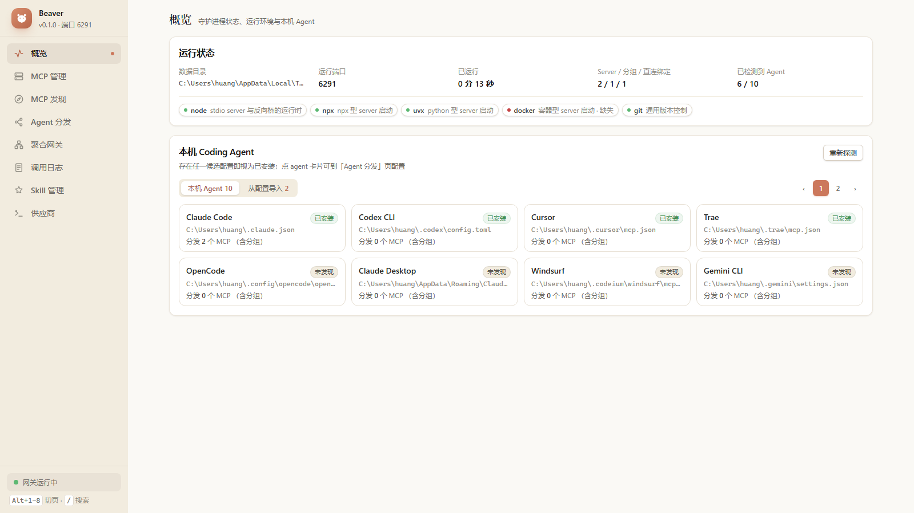
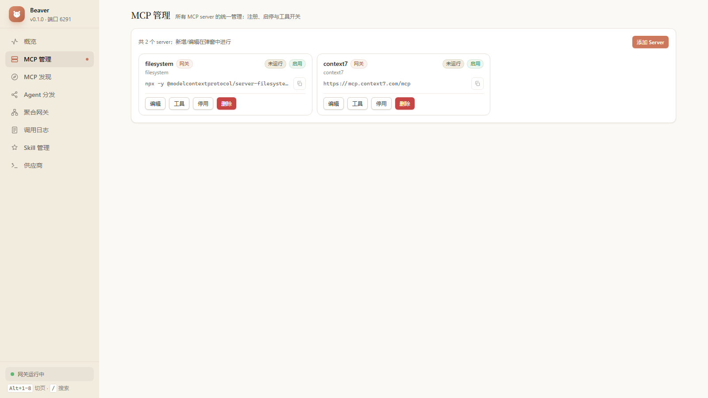
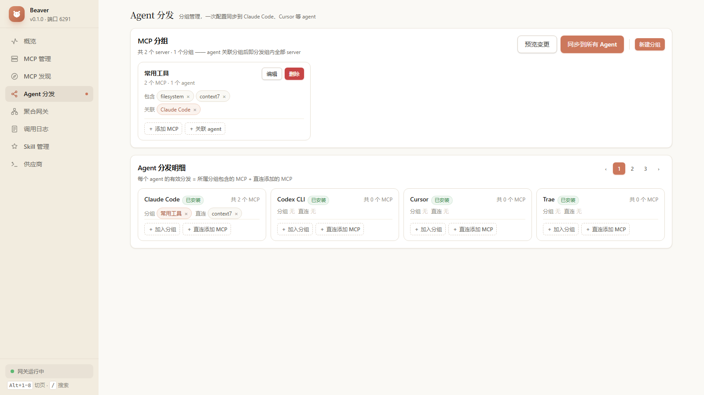
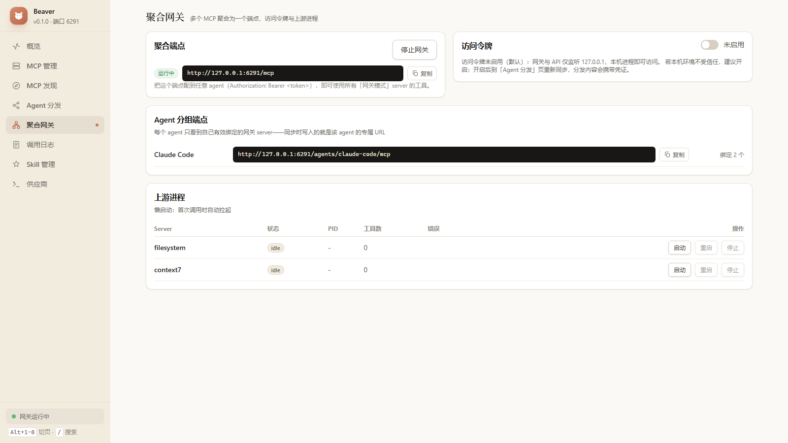
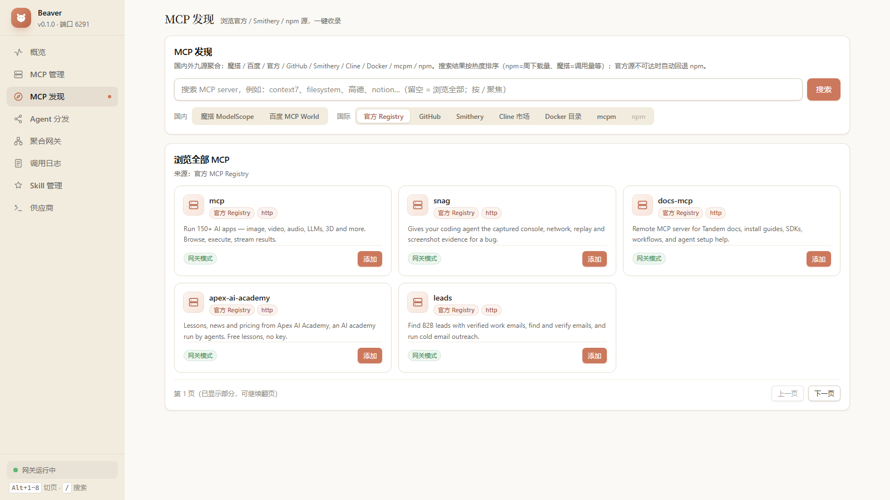
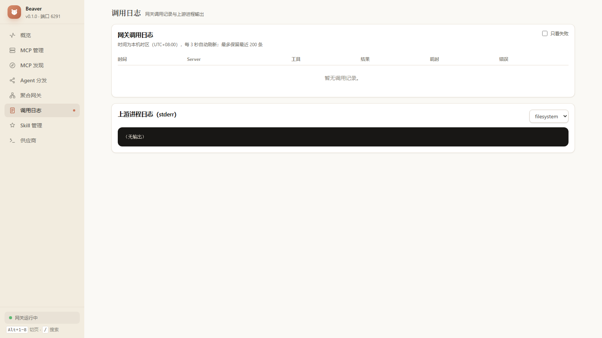
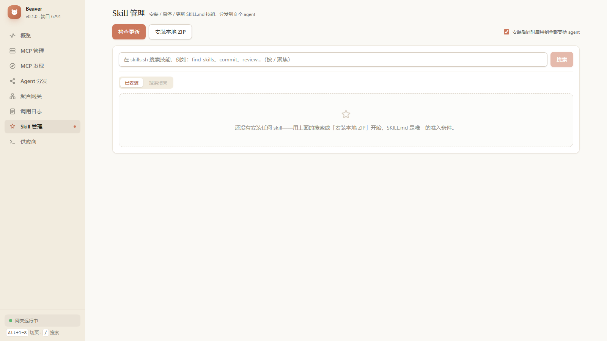

<p align="center">
  <picture>
    <source media="(prefers-color-scheme: dark)" srcset="docs/brand/logo-lockup-dark.png" />
    
  </picture>
</p>

# Beaver（河狸）

[](https://github.com/hxgh776/beaver/actions/workflows/ci.yml)


**Beaver**（单文件桌面程序，命令 `beaver`）——面向开发者个人电脑的 **Agent 装备总控台**：MCP Server **配置一次，多个 AI Coding Agent 一键启用**；可选网关模式统一聚合、代理、过滤与观测所有 MCP 流量。**Skill 管理**已内置。

> **Every agent's gear. One dam.** —— 河狸修坝：把所有水流收进同一座坝，每道闸门独立启闭，坝上看得见每一笔流量。配置一次，全局生效，很河狸。

支持 **10 个 Agent**：Claude Code · Codex CLI · Cursor · Trae · OpenCode · Claude Desktop · Windsurf · Gemini CLI · ZCode · WorkBuddy

## 🧭 它管什么、不管什么

- **Beaver 管"工具从哪来"**：MCP server / Skill 的注册、分发、网关代理、工具级过滤与调用观测；
- **[magpie](https://github.com/yetone/magpie) 管"模型从哪来"**：LLM API 网关（多供应商路由、订阅共享、用量计费）。
- 两者改写的配置字段不同（`mcpServers` vs model/baseURL），**可同时使用，互不冲突**：magpie 管模型，Beaver 管装备。

> [cc-switch](https://github.com/farion1231/cc-switch) 是本项目的灵感来源之一，Skill 管理的防御性写入设计吸收自它；重度多供应商路由需求建议直接用 magpie。

## ✨ 界面一览

| 概览（Agent 探测 / 运行环境 / 导入） | MCP 管理（卡片 + 弹窗编辑） |
|---|---|
|  |  |

| Agent 分发（分组批量管理 + 直连） | 聚合网关（聚合端点 / 上游进程） |
|---|---|
|  |  |

| MCP 发现（国内外九源，热度排序） | 调用日志（本机时区） |
|---|---|
|  |  |

| Skill 管理（skills.sh 搜索 / 启停矩阵 / 更新检查） |
|---|
|  |

## 🤔 为什么需要它

如果你的机器上装了多个 AI Coding Agent，你大概率遇到过：

- **同一个 MCP server 要配置 N 遍**——Claude Code 用 JSON、Codex 用 TOML、Cursor 又是另一个文件，改一处要改 N 处，极易不同步；
- **API Key 散落在每个 agent 的配置文件里**，轮换密钥 = 手改 N 个文件；
- **工具一多上下文爆炸**，却只能整体开关，没法精细控制每个 agent 看到哪些工具；
- **出了问题无从排查**——stdio 进程日志散落在各 agent 的缓存目录里。

Beaver 把所有 MCP Server 收进**单一注册表**，然后二选一（可混搭）地分发：

| | 直连模式 | 网关模式 |
|---|---|---|
| 原理 | 把真实配置写进各 agent | agent 只写一条指向本地网关的 URL |
| 凭证 | 随配置复制到各 agent | **只在本地一份，不落地 agent 配置** |
| 工具过滤 | 受 agent 能力限制 | 网关层工具级开关，改完即刻生效 |
| 进程 | 各 agent 各自拉起 | 全部 agent 共享一份进程 |
| 适合 | 本地文件/终端类 server | 远程 API 类、工具多的 server |

Codex 这类只支持 stdio 的 agent 也没问题——内置 **stdio 反向桥**，让它们同样能用上网关和远程 HTTP server。

## 🚀 快速开始

到 [Releases](https://github.com/hxgh776/beaver/releases) 下载对应平台的单文件（`beaver-vX.Y.Z-windows-x64.exe.zip` / `linux-x64.tar.gz` / `macos-arm64.tar.gz`），解压后：

```bash
beaver start      # daemon 后台常驻 + Web 面板（http://127.0.0.1:6280）
beaver tray       # 托盘常驻：打开面板 / 网关开关 / 立即同步 / 自启开关 / 退出
beaver open       # 用 Edge/Chrome 独立应用窗口打开面板
```

> **首次运行提示**：Windows SmartScreen 会拦一道——点「更多信息 → 仍要运行」（v1 不签名，证书后续迭代上）；macOS Gatekeeper 右键打开或 `xattr -cr beaver`。

**5 分钟上手路径**（首次进面板会由**首启向导**带着走完）：

1. **探测**：自动识别本机已安装的 agent；
2. **导入**：把各 agent 里现有的 MCP 配置收进注册表（跨 agent 自动按指纹去重）；
3. **同步**：勾选要启用的 agent → 一键分发。此后改配置/换密钥/开关工具都只在这一处。

免 Node、免安装、单文件 ~11 MB；数据目录 `~/.beaver`，监听恒为 127.0.0.1。

## 🖥 CLI

```bash
beaver start | stop | status
beaver servers list | servers add --name X --transport stdio --command npx --args ...
beaver agents             # 探测本机 agent
beaver import [--all]     # 从现有 agent 配置导入
beaver sync [--dry-run]   # 分发到各 agent
beaver gateway status | start | stop
beaver bridge <url> --token xxx    # stdio 反向桥（供 stdio agent 连远程端点）
beaver autostart on | off | status # 开机自启（Win: HKCU Run 键 + 隐藏窗口；macOS: LaunchAgent；Linux: systemd user unit）
beaver tray               # 托盘常驻：面板 / 网关开关 / 立即同步 / 自启开关 / 退出
beaver open               # 先确保 daemon 在跑，再用 Edge/Chrome 独立应用窗口打开面板
beaver --home <dir> ...   # 指定数据目录（缺省 ~/.beaver）
```

## 🤖 支持的 Agent

| Agent | 配置文件 | 网关模式 |
|---|---|---|
| Claude Code | `~/.claude.json` | ✅ 原生 |
| Codex CLI | `~/.codex/config.toml` | ✅ 经内置反向桥 |
| Cursor | `~/.cursor/mcp.json` | ✅ 原生 |
| Trae | `~/.trae/mcp.json` | ✅ 原生 |
| OpenCode | `~/.config/opencode/opencode.json` | ✅ 原生 |
| Claude Desktop | 分平台 `claude_desktop_config.json` | ✅ 原生 |
| Windsurf | `~/.codeium/windsurf/mcp_config.json` | ✅ 原生 |
| Gemini CLI | `~/.gemini/settings.json` | ✅ 原生 |
| ZCode | `~/.zcode/cli/config.json`（`mcp.servers`） | ✅ 原生 |
| WorkBuddy | `~/.workbuddy/mcp.json`（`type: streamableHttp`） | ✅ 原生 |

> 写入保真承诺：只动 MCP 配置键，写入前自动备份、原子写入、写后校验；你在配置里的手工修改会被检测并交给你决定，绝不静默覆盖。

## 🧰 核心能力

- **配置分发**：注册表为单一事实来源，勾选矩阵分发，支持冲突检测与 dry-run 预览；
- **MCP 网关**：多上游聚合成一个 streamable HTTP 端点；工具级开关、重名自动加前缀；上游懒启动、崩溃自愈（指数退避）；per-agent 分组端点让每个 agent 只看到自己的工具子集；
- **MCP 发现**：国内外九源聚合——官方 Registry、GitHub 镜像、Smithery、npm，国内魔搭 ModelScope MCP 广场与百度 MCP World，以及 Cline 市场、Docker MCP 目录、mcpm 聚合库；搜索按热度排序（npm 周下载量、魔搭调用量等），相关性过滤 + 按名去重，官方源不可达自动回退；
- **协议桥接**：stdio ↔ streamable HTTP / SSE 双向兼容，老协议 server 和老协议 agent 都能接入；
- **服务管理**：进程启停/重启、stderr 日志、调用日志（含耗时与错误）、工具调试台（不经 agent 直接调用）；
- **Skill 管理**：skills.sh 搜索 + GitHub/本地 ZIP 安装（128MiB/512MiB/30000 条目供应链预算、zip-slip 双防线、symlink 拒收），SSOT + 每-agent 启停矩阵（内容哈希所有权守卫），更新检查与卸载备份（保留 20 份）；
- **安全**：默认仅监听 127.0.0.1；访问令牌默认关闭、可在界面开启；上游凭证静态加密（Windows DPAPI），网关模式下不落地 agent 配置。

## ⬆️ 从 agent-control（npm 版）迁移

项目原名 **Agent Control**（`@hxgh776/agent-control`，命令 `actl`，Node 实现）。现在的 Beaver 是 Go 单文件桌面版，业务逻辑与原实现 1:1 对拍移植、数据格式完全兼容。迁移只需：`actl stop`（或杀掉原 daemon）→ 下载 beaver → `beaver start`。首次启动自动完成：

- 数据目录 `~/.agent-control` → `~/.beaver` 整体迁移（旧目录更名保留）；
- 各 agent 配置里的网关条目键名 `agent-control-gateway` → `beaver-gateway`，下次同步时旧键自动清理。

原 TypeScript 实现已退役，代码停在 tag [`ts-final`](https://github.com/hxgh776/beaver/tree/ts-final)。

## 📚 文档

- [需求分析](docs/requirements-analysis.md)
- [实施方案](docs/implementation-plan.md)
- [验收报告](docs/acceptance-report.md)（含性能与安全实测数据）

## 🛠 开发

后端 Go，前端 React（`packages/web`，构建产物经 `go:embed` 打进二进制）：

```bash
go build -o beaver ./cmd/beaver        # 单文件 CLI + daemon + 托盘
go test ./...                           # 128 个用例（含真实 stdio/HTTP 上游网关全链路）
pnpm install && pnpm build              # 构建 Web UI 并同步到 internal/webui/dist（改 UI 后必做，再 go build）
cd e2e && npx playwright install chromium && pnpm test   # Playwright 冒烟 9 条，默认起仓库根的 ./beaver
export GOPROXY=https://goproxy.cn,direct                 # 国内代理（CI 无需）
```

> 所有自动化测试通过沙箱目录重定向，**绝不读写真实 agent 配置**。
> Linux 构建需 `libayatana-appindicator3-dev libgtk-3-dev`（托盘 cgo 后端）；Windows 纯 Go，macOS 需 Xcode 命令行工具。
> 版本号单点 `internal/version/version.go`，CI 以 `-ldflags -X ...value=<tag>` 注入。

## 🗺 Roadmap

- [x] ~~Go 单文件桌面版~~（替代 Node 实现，[v0.1.0](https://github.com/hxgh776/beaver/releases/tag/v0.1.0)）
- [x] ~~Skill 管理~~（skills.sh 搜索 + GitHub/ZIP 安装 + 启停矩阵 + 更新检查）
- [x] ~~更名 Beaver~~（含 magpie 互补定位：magpie 管模型，Beaver 管装备）
- [x] ~~桌面化交付~~（Go 单文件 exe + 托盘 + 全规格面板窗口 + 设置页 + 首启向导；二进制经 go-build workflow 手动产出，[方案](docs/desktop-plan.md)）
- [ ] 项目级作用域（per-project 分发）
- [ ] VS Code 适配器
- [ ] macOS Keychain / Linux libsecret 凭证加密

## 📄 License

[MIT](LICENSE)
